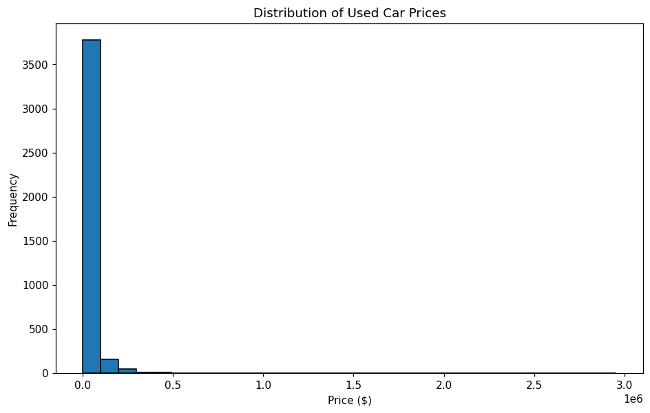

# Used Car Price Analysis and Prediction

**Author:** Benjamin Dwomoh  
**Context:** MSc Data Analytics coursework, reviewed for a public portfolio  
**Tools:** Python, pandas, NumPy, Matplotlib, seaborn, scikit-learn

## Analytical question

How well can vehicle attributes estimate advertised used-car asking prices, and how does target transformation affect interpretation?

## Data and my contribution

4,009 vehicle listings and 12 original columns from the Used Car Price Prediction Dataset cited in my coursework. I worked on data preparation, analysis, modelling and interpretation; I did not collect the original dataset.

## Approach

Numeric conversion of price and mileage; missing-category handling; EDA and outlier exploration; log-price target; 80/20 holdout; preprocessing pipelines; Linear Regression, Random Forest and Gradient Boosting; dollar and log-scale error comparison; grouped feature importance and a median baseline.

## Results

| Model | Dollar MAE | Dollar RMSE | Dollar R-squared | Log-price R-squared |
| --- | ---: | ---: | ---: | ---: |
| Linear Regression | 20,728.13 | 138,178.80 | 0.066 | 0.683 |
| Random Forest | 20,440.14 | 135,359.03 | 0.104 | 0.716 |
| Gradient Boosting | 21,344.43 | 137,117.24 | 0.080 | 0.705 |

Random Forest performed best among the three models on this split. However, its dollar-scale fit remained weak, and a typical absolute error of about USD 20,440 is material. This analysis demonstrates a workflow and its limitations, not a production-ready valuation service. The training-median baseline had dollar MAE of USD 32,865.97 and RMSE of USD 144,218.92. Random Forest improved on that baseline, while still leaving substantial valuation error.

## Example chart



## Limitations

Asking prices are not verified sale prices. Extreme prices dominate dollar errors. Log-price R-squared is not percentage accuracy and cannot substitute for dollar-scale evaluation. Only one holdout split is used. Dataset representativeness, listing duplication and unobserved vehicle condition warrant further validation. Impurity-based feature importance is not causal.

## Run the analysis

Use Python 3.11 or newer. From this repository folder:

```bash
python -m venv .venv
```

Activate the environment on Windows PowerShell:

```powershell
.venv\Scripts\Activate.ps1
```

Or on macOS/Linux:

```bash
source .venv/bin/activate
```

Then install the packages and start Jupyter:

```bash
python -m pip install -r requirements.txt
python -m jupyter lab
```

Place the source dataset in `data/` as described in [data/README.md](data/README.md). Open [analysis.ipynb](analysis.ipynb), then restart the kernel and run all cells. The notebook includes saved outputs for readers who only want to inspect the work.

Core analysis package versions are pinned to the validation environment. JupyterLab is a frontend dependency; it was not available in the validation environment. Validation executed Python cells sequentially with a lightweight runner and captured tables and Matplotlib outputs rather than using a Jupyter kernel.


## Files

- `analysis.ipynb`: explained analysis with executed outputs.
- `figures/`: saved charts produced by the notebook.
- `requirements.txt`: analysis dependencies.
- `data/README.md`: dataset source and placement instructions.
- `VALIDATION.md`: execution checks and scope.

## Source

Najib, T. Used Car Price Prediction Dataset. Kaggle. The source is cited in my submitted report. Redistribution terms were not independently confirmed during preparation, so the raw CSV is excluded.

https://www.kaggle.com/datasets/taeefnajib/used-car-price-prediction-dataset
