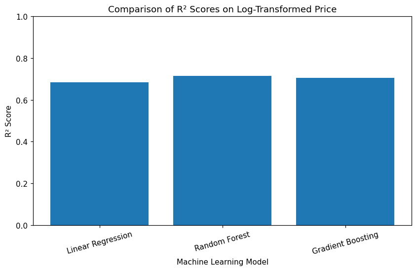
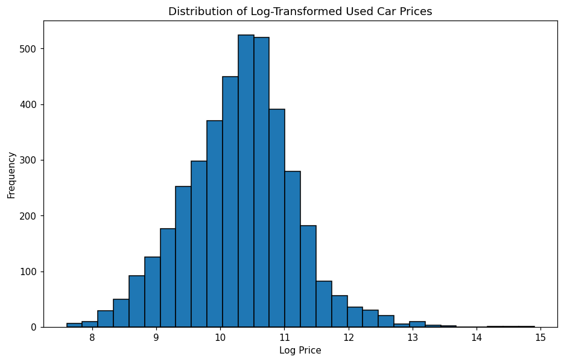
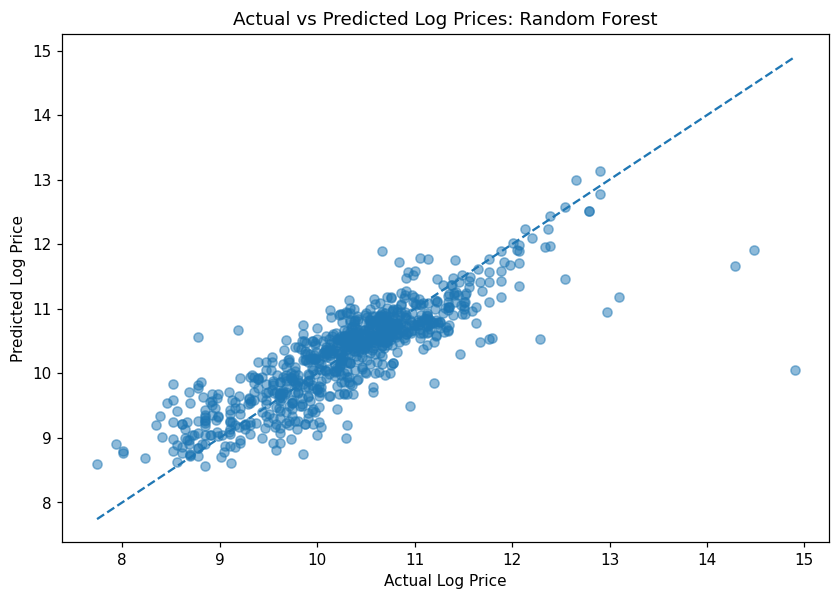
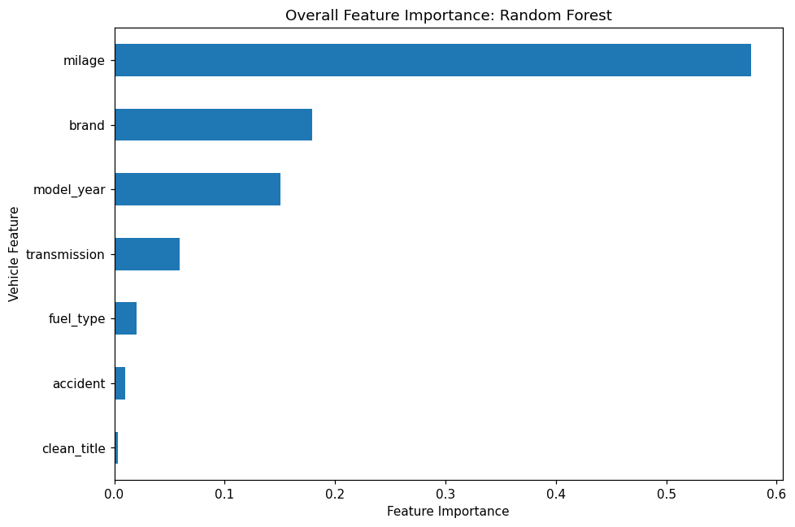

# Used Car Price Analysis and Prediction

**Author:** Benjamin Dwomoh  
**Portfolio context:** Developed from MSc Data Analytics coursework and revised for reproducibility, business interpretation and responsible model reporting.
**Tools:** Python, pandas, NumPy, Matplotlib, seaborn and scikit-learn

## Project overview

This project analyses **4,009 used-car listings** and compares three regression models for estimating advertised asking prices from vehicle characteristics. The workflow covers data auditing, cleaning, exploratory analysis, target transformation, preprocessing pipelines, baseline comparison, model evaluation and grouped feature importance.

The project demonstrates an end-to-end regression workflow while also showing why a model can perform reasonably on log-transformed prices but remain unreliable for high-value vehicles on the original dollar scale.

## Business problem

Used-car buyers, sellers and marketplaces need consistent price estimates. A useful pricing model should identify broad market patterns, provide a reasonable reference point and clearly communicate uncertainty—especially for rare or unusually expensive vehicles.

This analysis addresses four questions:

1. How are used-car asking prices distributed, and how strongly do extreme listings affect evaluation?
2. How are vehicle age, mileage, brand and other recorded characteristics associated with asking price?
3. Which of Linear Regression, Random Forest and Gradient Boosting performs best on a reproducible holdout set?
4. Does the best model improve meaningfully on a simple median-price baseline?

## Dataset and contribution

The source dataset contains **4,009 listings and 12 original columns**. I prepared the data, conducted the exploratory analysis, built the preprocessing and modelling pipelines, evaluated the models and interpreted the results. I did not collect the original listings.

Important dataset characteristics include:

- Median asking price: **USD 31,000**
- Mean asking price: **USD 44,553**
- Maximum asking price: approximately **USD 2.95 million**
- Median mileage: **52,775 miles**
- Price outliers above the IQR upper bound: **244 listings**
- Missing `clean_title` values: **14.87%**
- Missing `fuel_type` values: **4.24%**
- Missing `accident` values: **2.82%**

The source column is spelled `milage`; the analysis preserves that original field name in the code while referring to it as mileage in the documentation.

## Analytical workflow

1. Audit the schema, missing values, duplicates and data types.
2. Convert formatted mileage and price strings into numerical values.
3. Represent missing categorical information explicitly as `Unknown`.
4. Explore prices, mileage, vehicle age, fuel type and accident history.
5. Apply `log(1 + price)` to reduce extreme target skewness.
6. Create an 80/20 train-test split and fit preprocessing only on training data.
7. Train Linear Regression, Random Forest and Gradient Boosting models.
8. Evaluate predictions on both log and original dollar scales.
9. Compare the models with a training-median baseline.
10. Aggregate Random Forest feature importance back to the original vehicle characteristics.

## Model results

### Original dollar scale

| Model | MAE (USD) | RMSE (USD) | R-squared |
|---|---:|---:|---:|
| Linear Regression | 20,728.13 | 138,178.80 | 0.066 |
| **Random Forest** | **20,440.14** | **135,359.03** | **0.104** |
| Gradient Boosting | 21,344.43 | 137,117.24 | 0.080 |
| Training-median baseline | 32,865.97 | 144,218.92 | -0.018 |

### Log-price scale

| Model | Log MAE | Log RMSE | Log R-squared |
|---|---:|---:|---:|
| Linear Regression | 0.333 | 0.497 | 0.683 |
| **Random Forest** | **0.328** | **0.471** | **0.716** |
| Gradient Boosting | 0.337 | 0.479 | 0.705 |

Random Forest performed best among the three models on this split and improved substantially on the median baseline's MAE. However, an MAE of approximately **USD 20,440** remains material, and the low dollar-scale R-squared shows that the model does not explain high-value price variation adequately.



## Selected visual results

### Log transformation reduced target skewness

The original price distribution had skewness of **19.51**. After applying `log(1 + price)`, skewness fell to **0.11**, producing a distribution that was more suitable for the regression exercise.



### Actual versus predicted log prices



The fit is considerably clearer on the log scale. This must not be presented as equivalent performance in dollars or as percentage accuracy.

### Grouped feature importance



Within this fitted Random Forest, grouped impurity importance was approximately:

| Recorded feature | Importance |
|---|---:|
| Mileage | 57.67% |
| Brand | 17.92% |
| Model year | 15.08% |
| Transmission | 5.94% |
| Fuel type | 2.03% |
| Accident history | 1.02% |
| Clean-title status | 0.33% |

These values describe the fitted model. They do not establish that a feature causes a change in price, and impurity-based importance can favour continuous or high-cardinality predictors.

## Business interpretation and recommendations

- **Use the model as a broad benchmark, not an automatic valuation:** The model improves on a median-price rule but its typical dollar error is too large for unsupervised pricing decisions.
- **Report a price range:** Any future user-facing version should provide an uncertainty interval or comparable-listing range rather than a single point estimate.
- **Separate ordinary and luxury vehicles:** The extreme upper tail strongly affects dollar errors. A specialist model or separate market segment may be required for rare and luxury vehicles.
- **Improve vehicle-detail features:** Exact model, trim, engine specification, condition, location and listing age are commercially important but are either excluded from the current model or inadequately represented.
- **Validate on newer listings:** A temporal holdout would better test whether the model generalises to future market conditions.
- **Evaluate beyond aggregate averages:** Report errors by price band, brand and vehicle age so that poor performance in smaller segments is not hidden by an overall metric.

## Limitations

- Prices are advertised asking prices, not verified transaction prices.
- The dataset contains extreme prices that dominate RMSE and dollar-scale R-squared.
- Only one random 80/20 holdout split is used; there is no cross-validation or temporal validation.
- The exact vehicle `model` and detailed `engine` fields are not included in the current modelling features, limiting predictive information.
- Listing location, condition, optional equipment and listing date are unavailable.
- Potential duplicate vehicles cannot be ruled out using the available identifiers.
- Log-price R-squared is not percentage accuracy and cannot replace dollar-scale evaluation.
- Random Forest impurity importance is neither causal nor necessarily unbiased.
- This is a portfolio analysis, not a production-ready vehicle valuation service.

## Run the analysis

Use Python 3.11 or newer. From the repository folder, create and activate a virtual environment.

```bash
python -m venv .venv
```

Windows PowerShell:

```powershell
.venv\Scripts\Activate.ps1
```

macOS/Linux:

```bash
source .venv/bin/activate
```

Install the packages and start Jupyter:

```bash
python -m pip install -r requirements.txt
python -m jupyter lab
```

Place the source dataset in `data/` as described in [data/README.md](data/README.md). Open [analysis.ipynb](analysis.ipynb), restart the kernel and run all cells. Saved outputs are included for readers who only want to inspect the work.

## Repository structure

```text
used-car-price-prediction/
├── analysis.ipynb       # Explained analysis with executed outputs
├── figures/             # Seventeen exported analysis charts
├── data/README.md       # Dataset source and placement instructions
├── requirements.txt     # Analysis dependencies
├── VALIDATION.md        # Execution and scope checks
├── LICENSE              # Licence for the original project code
└── README.md            # Project overview and findings
```

## Validation

The analytical workflow underlying the saved results was executed sequentially against the supplied dataset without errors. A later presentation-only cleanup removed a redundant import without changing the analytical logic or saved results. See [VALIDATION.md](VALIDATION.md) for details.

## Data source

Najib, T. *Used Car Price Prediction Dataset*. Kaggle.

https://www.kaggle.com/datasets/taeefnajib/used-car-price-prediction-dataset

The raw CSV is excluded because its redistribution terms were not independently confirmed. The licence below applies to the original project code, not automatically to the source dataset.
